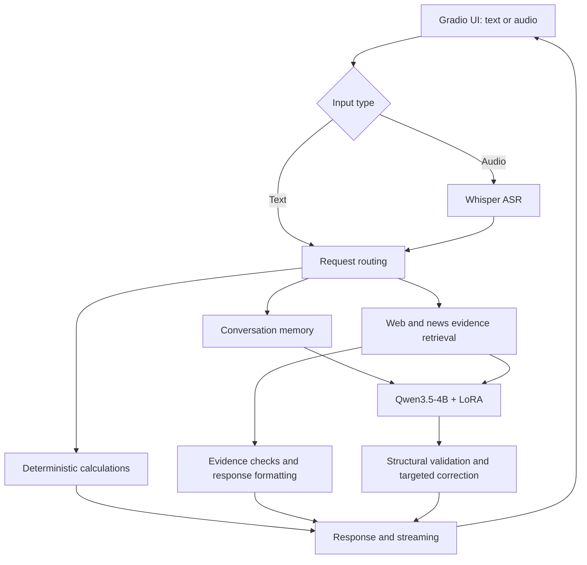

# DEGHEIDY NEXUS AI

**Fine-tuned multilingual AI assistant | LLM orchestration | Speech recognition**

   

[Arabic documentation](README_AR.md) · [Colab notebook](NEXUS_AI_Colab.ipynb) · [Evaluation notes](docs/EVALUATION.md)

## Overview

NEXUS AI is a multilingual assistant built around Qwen3.5-4B and a separately trained LoRA adapter. It combines Arabic–English conversational generation with speech-to-text, conversation memory, deterministic calculations, live web/news retrieval and heuristic response validation. The project demonstrates end-to-end LLM application engineering and GPU-based adaptation, without requiring an OpenAI API key.

## Capabilities

- Arabic and English conversation, including mixed-language prompts.
- Qwen3.5-4B inference with a compatible LoRA adapter; training scripts and curated dataset are included.
- Whisper-based speech-to-text; Gradio interface with streaming, cancellation and recovery.
- Context-aware conversation memory and repeat-answer handling for eligible static prompts.
- Deterministic calculation paths for supported arithmetic requests.
- Web/news evidence retrieval, publisher links and official-domain checks where supported; explicit uncertainty when evidence is insufficient.
- Structural response checks and targeted correction for selected multi-part requests.

## Architecture



The diagram shows logical capabilities, not a guarantee that every request uses every component. This is an orchestrated LLM application, not a claim of a fully autonomous multi-agent system or a production-scale PDF indexing platform.

## Quick start — Google Colab

1. Open `NEXUS_AI_Colab.ipynb` in Google Colab and select a GPU runtime (Tesla T4 was used during development).
2. Run Stage 1 to restore the bundled source and install dependencies.
3. Run Stage 2 and provide your own compatible trained adapter ZIP if requested (`DEGHEIDY_QA74_COMPAT_TRAINED_ADAPTER.zip`). The trained weights are **not included** in this repository. The included training code is provided for reproducibility; the notebook restores an existing adapter rather than training a new one.
4. Run Stage 3 and open the newly verified UI link. Do not share a public Gradio URL containing private conversations.
5. Stage 4 performs real acceptance runs and closes the UI first. Stage 5 checks reviewed evidence before release. Rerun Stage 3, or use `reopen_chat_colab.py` in a compatible active Colab session, to reopen the UI.

## Repository structure

```text
app.py                     Application and Gradio interface
src/                       Routing, generation, memory, search and speech
training/                  LoRA training scripts and curated dataset
scripts/release_gate.py    Human-reviewed acceptance checks
evaluation/                Evaluation prompts
acceptance_suite.py        Actual application acceptance runner
benchmark.py               Benchmark runner
tests/                     Automated regression tests
NEXUS_AI_Colab.ipynb         Colab setup, adapter restore and evaluation
reopen_chat_colab.py        Optional Colab UI recovery helper
docs/                      Evaluation notes and development history
```

## Evaluation

| Evidence | Result |
|---|---|
| Automated software tests (recorded development run) | 244 passed + 13 subtests |
| Arithmetic stress test | 1,000 reproducible variants within the automated suite |
| Latest manual interactive evaluation | 8.20/10 across 10 rated cases |
| Speech recognition accuracy | Not established with reference audio |
| Final release approval | Pending |

The manual score is a small internal evaluation, not an accuracy percentage, standardized benchmark, or independent certification. Search and generation fixtures in local tests are mocked; the 1,000 variants are not real LLM generations. See [evaluation details](docs/EVALUATION.md).

To run source regression tests in a compatible environment after installing dependencies: `python -m pytest -q`.

## Known limitations

- News retrieval can return no matching results or incomplete evidence, even for broad queries.
- Some compound requests omit a requested calculation or instruction; longer responses can be incomplete.
- Conversation recall can confuse unmentioned facts with absent experience.
- Actual speech recognition error rates, production latency, security and load capacity are not established.
- The release candidate is not production-certified. Two reviewed real runs exceeding 8.10/10 and the existing strict checks are required for final promotion.

## Author

Yousef Degheidy — AI/ML engineering portfolio project.

Do not commit credentials, private logs, audio recordings or trained adapter archives. Model and dependency terms apply independently; no new project license is asserted here.
